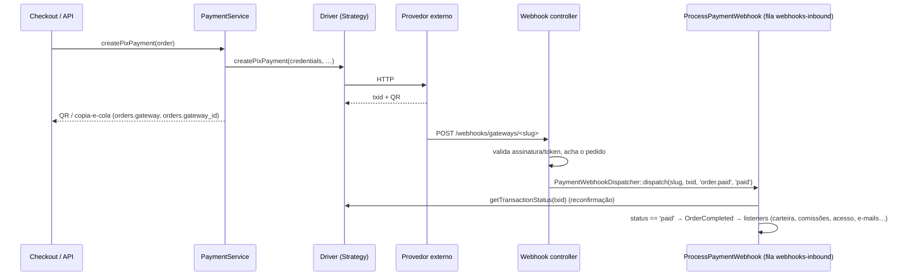

# Provedores de pagamento (gateways)

Como a plataforma conversa com PSPs, adquirentes e afins, e o que é preciso para plugar um provedor novo.

No código, todo provedor se chama **gateway** e é identificado por um **slug** (`cajupay`, `efi`, `okto`…). As telas às vezes chamam de "adquirente" qualquer provedor, mesmo quando é um PSP.

## Resumo em 6 pontos

1. **Só a cobrança (pay-in) usa uma interface.** `GatewayDriver` tem 5 métodos: testar conexão, criar PIX, criar cartão, criar boleto e consultar status. Cada provedor é uma implementação dessa interface (padrão **Strategy**), escolhida pelo slug.
2. **O fallback entre provedores é um laço simples.** O `PaymentService` percorre uma lista ordenada de slugs por método e, se um provedor falha, tenta o próximo. Não é uma Chain of Responsibility formal.
3. **PIX OUT (saque), estorno, MED, Pix Automático e saldo NÃO têm interface.** Cada provedor entra por `match ($slug)` / `if ($slug === '…')` espalhados pelo código. Um provedor completo como o Okto exigiu mudanças em **33 arquivos**.
4. **As "categorias" PSP / Adquirente / Open Finance existem só no frontend.** São uma constante numa tela Vue e o backend não sabe nada delas. Um provedor que não estiver listado ali cai automaticamente em "PSP".
5. **Um provedor novo só aparece se o slug estiver em `platform_acquirer_slugs`** (`config/gateways.php`). Sem isso, ele some de todas as telas e da ordem de cobrança, sem nenhum erro.
6. **Plugins podem registrar provedores sem mexer no core**, mas pelo caminho de plugin só funciona a cobrança e o webhook. Saque, estorno, MED e badges continuam hardcoded no core.

---

## 1. Peças principais

```
config/gateways.php                 ← definição de cada provedor (metadados + driver + campos de credencial)
        │
        ▼
app/Gateways/GatewayRegistry.php    ← junta config + provedores registrados por plugins; resolve o driver pelo slug
        │
        ▼
app/Gateways/Contracts/GatewayDriver.php  ← interface (Strategy) implementada por cada provedor
app/Gateways/<Nome>/<Nome>Driver.php      ← implementação concreta (16 hoje)
        │
        ▼
app/Services/PaymentService.php     ← escolhe o provedor por método, faz o fallback, grava no pedido
app/Models/GatewayCredential.php    ← credenciais criptografadas por provedor (global ou por tenant)
```

### 1.1 A interface `GatewayDriver`

[app/Gateways/Contracts/GatewayDriver.php](../../app/Gateways/Contracts/GatewayDriver.php)

| Método | Retorno esperado |
|---|---|
| `testConnection(array $credentials): bool` | `true` se as credenciais funcionam. É chamado ao salvar e testar na tela de admin, e o resultado é gravado em `is_connected` |
| `createPixPayment(array $credentials, float $amount, array $consumer, string $externalId, string $postbackUrl, array $options = []): array` | `transaction_id` (obrigatório), `copy_paste` e/ou `qrcode` (pelo menos um, senão dá erro "PIX gerado sem código de pagamento") e, opcionalmente, `metadata` (mesclado em `orders.metadata`) e `raw` |
| `createCardPayment(array $credentials, float $amount, array $consumer, string $externalId, array $card): array` | `transaction_id`, `status` e, opcionalmente, `metadata`, `client_secret`, `redirect_url`, `status_detail` e `charged_amount`. `$card` traz `payment_token` (tokenizado no navegador) e `card_mask` |
| `createBoletoPayment(array $credentials, float $amount, array $consumer, string $externalId, string $notificationUrl): array` | `transaction_id`, `amount`, `expire_at`, `barcode` e `pdf_url` |
| `getTransactionStatus(string $transactionId, array $credentials): ?string` | `'paid'`, `'pending'`, `'cancelled'` ou `null`. **É crítico:** o webhook só aprova o pedido depois de reconfirmar o status aqui, e a reconciliação agendada também usa este método |

- `$consumer` é `{name, document, email}`.
- `$externalId` é o `id` do pedido.
- Um método que o provedor não suporta continua existindo, mas lança exceção (ex.: o Okto lança `RuntimeException('Okto não suporta …')` para cartão e boleto).

**Métodos "extras" chamados sem interface (duck typing).** Eles existem nos drivers e são chamados por `method_exists`, `is_callable` ou `instanceof` com a classe concreta:

| Método | Para quê | Quem chama |
|---|---|---|
| `refundTransaction($credentials, $txId, $amount, $externalId)` | Estorno | `OrderRefundGatewayBridge`, mas só depois de um `match` por slug |
| `getTransferStatus(...)` | Status de saque (PIX OUT) | Jobs `Reconcile<X>WithdrawalJob` |
| `fetchAccountBalance(...)` | Saldo no provedor | `AcquirerWalletBalanceService` |
| `handleWebhook(Request)` | Webhook genérico (provedor de plugin) | `GenericGatewayWebhookController` |
| `registerWebhookUrls(...)` | Cadastrar a URL de webhook no provedor | `<X>WebhookBootstrapService` |

### 1.2 Definição do provedor — `config/gateways.php`

Exemplo real (Okto), resumido:

```php
'okto' => [
    'slug' => 'okto',
    'name' => 'Okto',
    'image' => 'images/gateways/okto_payments.svg',      // em public/
    'methods' => ['pix'],                                 // pix | card | boleto | pix_auto | open_finance | paypal
    'scope' => 'national',                                // national | international (só UI)
    'country' => 'br', 'country_name' => 'Brasil', 'country_flag' => 'brasil.png',
    'signup_url' => 'https://…',
    'support_contacts' => [['name' => '…', 'role' => 'Gerente de contas', 'whatsapp' => '55…']],
    'driver' => \App\Gateways\Okto\OktoDriver::class,
    'credential_keys' => [                                // gera o formulário da tela de admin
        ['key' => 'access_token', 'label' => 'Access token', 'type' => 'password'],
        ['key' => 'rsa_public_key', 'label' => 'Chave pública RSA', 'type' => 'textarea'],
        ['key' => 'sandbox', 'label' => 'Usar staging', 'type' => 'boolean'],
        ['key' => 'okto_payout_min_brl', 'label' => 'Mínimo de payout (R$)', 'type' => 'text', 'optional' => true],
        // + okto_admin_fee_pix_brl|percent, okto_admin_fee_payout_brl|percent
    ],
],
```

Chaves e quem as lê:

| Chave | Efeito |
|---|---|
| `methods` | Em quais métodos o provedor entra na ordem de cobrança e quais chips aparecem no card |
| `driver` | Classe instanciada pelo container (`app($class)`), então aceita injeção de dependência no construtor |
| `credential_keys[]` | Campos do formulário: `key`, `label`, `type` (`text`/`password`/`boolean`/`file`/`textarea`), `optional`, `hint`, `group`/`group_label`, `accept`/`file_kind` (para `file`) |
| `checkout_payload_keys` | Credenciais **públicas** expostas ao checkout em `card_gateway_keys[slug]` (ex.: chave pública para tokenizar cartão) |
| `certificate_key` | Upload de certificado (`.p12` da Efí) |
| `oauth` | Fluxo OAuth na tela de credenciais |
| `requires_plugin` | O provedor só é liberado com um plugin habilitado |
| `webhook_handler` | Só para provedores de plugin: classe ou callable que trata `POST /webhooks/gateways/{slug}` |
| `scope`, `country*`, `signup_url`, `support_contacts` | Apenas visuais |

Convenção de nomes de credencial: `GatewayPayoutEconomics` lê automaticamente `{slug}_payout_min_brl`, `{slug}_admin_fee_pix_brl|percent` e `{slug}_admin_fee_payout_brl|percent`. Basta declarar esses campos para ter mínimo de saque e taxas administrativas, sem código extra.

Chaves no nível superior do arquivo:

- **`platform_acquirer_slugs`**: lista de provedores habilitados na plataforma, que também define a ordem de exibição. **Um provedor novo precisa entrar aqui.**
- **`default_order`**: ordem padrão de fallback por método, usada quando o admin ainda não configurou nada.
- **`api_pix_excluded_slugs`**: provedores que não podem cobrar pedidos vindos da API ou do PixGO.

### 1.3 `GatewayRegistry`

[app/Gateways/GatewayRegistry.php](../../app/Gateways/GatewayRegistry.php), todo estático:

- `register(array $def)` — usado por plugins no `bootstrap.php`.
- `all()` — faz `config('gateways.gateways')` + o que os plugins registraram. Um plugin com o mesmo slug **sobrescreve** o core.
- `allowedAcquirers()` — `all()` filtrado e ordenado por `platform_acquirer_slugs`. É o que as telas de admin usam.
- `driver($slug)` — instancia o driver e devolve `null` se a classe não existir ou não implementar `GatewayDriver`.
- `resolveImageUrl()` — aceita `plugin:{slug}/{arquivo}` para logos servidos pelo plugin.

### 1.4 Credenciais — `GatewayCredential`

Tabela `gateway_credentials`: `tenant_id`, `gateway_slug`, `credentials` (JSON criptografado), `is_connected`, `is_enabled`.

- **Global** (`tenant_id = null`) é configurada pelo admin da plataforma em `/plataforma/financeiro`. **Por tenant** é o modelo legado.
- `GatewayCredential::resolveForPayment($tenantId, $slug)` procura **primeiro a global** (com `is_connected = true` e `is_enabled` verdadeiro ou nulo) e só depois a do tenant.
- A CajuPay é exceção: suporta várias contas, no model `CajuPayAccount` com `CajuPayAccountResolver`.

### 1.5 Escolha do provedor e fallback — `PaymentService`

[app/Services/PaymentService.php](../../app/Services/PaymentService.php)

**Ordem de tentativa** (`getGatewayOrderForMethod`):
1. Ordem global: setting `gateway_order` do tenant, senão a da plataforma, senão `config('gateways.default_order')`. É filtrada por `platform_acquirer_slugs`, e no fim entram os provedores habilitados que suportam o método mas não estavam na lista.
2. Se o **produto** define um provedor fixo para o método (`checkout_config.payment_gateways`), usa esse provedor e a lista `<metodo>_redundancy` dele.
3. Senão, a preferência do vendedor (`merchant_gateway_order`) vem primeiro, e o resto da ordem global depois.

**Laço de fallback** (`createPixPayment`; cartão e boleto funcionam igual):

```
para cada slug na ordem:
    pula se: passou de 25 s no total | provedor bloqueado para esse tipo de pedido
             | sem credencial conectada/habilitada | GatewayApiCredentials::isReadyForGateway = false
             | sem driver
    tenta driver->createPixPayment(...)
        sucesso → grava orders.gateway = slug, orders.gateway_id = transaction_id, metadata → retorna
        exceção → loga e tenta o próximo
fim → relança a última exceção ou "Nenhum gateway PIX configurado ou disponível."
```

**Um provedor só cobra se**, ao mesmo tempo:
- está em `platform_acquirer_slugs`;
- tem credencial conectada e habilitada;
- tem o método em `methods`;
- o método está habilitado na plataforma e no produto;
- no caso de PIX, passa no `match` de `app/Support/GatewayApiCredentials.php`. Quando o slug não está nesse `match`, o padrão é `true`.

### 1.6 Ciclo de vida do pagamento



- **Webhook de um provedor do core:** controller próprio em `app/Http/Controllers/Webhooks/<Nome>WebhookController.php` e rota explícita em `routes/web.php`, **antes** da rota genérica `{slug}`. A URL que o admin vê vem de `app/Support/GatewayWebhookUrl.php` (um `match` com padrão `/webhooks/gateways/{slug}`).
- **Webhook de um provedor de plugin:** `POST /webhooks/gateways/{slug}` cai no `GenericGatewayWebhookController`, que chama o `webhook_handler` da definição ou o `handleWebhook()` do driver.
- **Vocabulário de eventos esperado pelo job:**
  - `order.paid` com status `paid`;
  - `order.cancelled` / `cancelled`;
  - `order.rejected` / `rejected`;
  - `order.refunded` / `refunded`;
  - `order.disputed` / `chargeback`.
- **Reconfirmação:** o job só aprova depois que `getTransactionStatus` responde `'paid'`. Se o provedor não responder, quem decide é `config/webhooks.php` → `reconfirm_fail_policy.<slug>`.
- **Rede de segurança:** `payments:reconcile-pending` roda a cada 2 minutos e chama `getTransactionStatus` em todos os pedidos pendentes. É genérico e funciona para qualquer driver.

---

## 2. Capacidades fora da interface (hardcoded por slug)

### 2.1 PIX OUT (saques)

Não existe um `PayoutDriver`. Hoje funciona assim:

- **Qual provedor paga os saques:** `PlatformPayoutGateway::activeSlug()` usa o setting `platform_payout_gateway` (`auto` ou um slug). Em `auto`, usa o primeiro provedor conectado de `PAYOUT_ORDER`.
- **Disparo:** `WithdrawalAutoPayoutService::attemptAutoPayout` faz `match ($slug) { 'okto' => $this->attemptOkto(...), … }`. Cada `attemptX` chama `XPayoutService::sendWithdrawalToPix()`, grava `withdrawals.payout_provider` e `payout_external_id` e agenda `ReconcileXWithdrawalJob` com 90 s de atraso.
- **Confirmação:** webhook de transferência e/ou o comando `withdrawals:reconcile-<slug>`, agendado em `bootstrap/app.php`. Eles chamam `MerchantWithdrawalService::markPaid/markFailed`.
- **Aprovação manual pelo admin:** `Platform\FinancialController::approveWithdrawal` duplica um bloco `if ($slug === …)` por provedor.

> ⚠️ **Bug encontrado:** `approveWithdrawal` não tem bloco para `versell`. Se a Versell for o provedor de saque ativo, aprovar o saque pela tela de admin cai em "Gateway de payout não suportado."

### 2.2 Estorno

`OrderRefundGatewayBridge::tryRefund` exige que o driver tenha `refundTransaction()` e, mesmo assim, faz `match ($slug)` com apenas `cajupay`, `versell`, `cielo`, `xflow` e `okto`. Os outros caem em "Estorno automático não implementado; conclua no adquirente".

### 2.3 MED (disputas PIX)

Um service por provedor (`CajuPayMedService`, `VersellMedService`, `BspayMedService`, `XflowMedService`), alimentado pelo webhook de cada um. A defesa é encaminhada por uma cadeia de `if/elseif` em `Platform\MedDisputesController` e em `SellerMedDisputesController`. Quando nenhum `if` bate, o padrão é a CajuPay.

### 2.4 Pix Automático (recorrência)

O provedor é escolhido por `getFirstAvailableGatewayForMethod('pix_auto')`, mas a criação é um `if` por slug (`pushinpay`, `efi`, `versell`) em `CheckoutController` e `ApiCheckoutController`. As renovações também são por slug, em `ProcessPaymentWebhook` e `RenewalController`.

### 2.5 Cartão no checkout (frontend)

O checkout tokeniza o cartão no navegador, e isso também é por slug em `resources/js/components/checkout/CheckoutForm.vue` (`isCardGatewayStripe`, `…Pagarme`, `…Cielo`…).

> ⚠️ **Armadilha:** um provedor de cartão que não esteja reconhecido ali **cai na tokenização da Efí** e falha com "card_not_configured". As chaves públicas vão para o checkout por `checkout_payload_keys`. A mesma lógica está duplicada em `RenewalController` / `Renewal/Show.vue` e em `ApiCheckoutController` / `ApiCheckout/Show.vue`.

### 2.6 Saldo no provedor

`AcquirerWalletBalanceService` mostra o saldo de cada provedor no painel do admin. Ele tem uma lista `BALANCE_SLUGS` e um `match` para `fetchX()`.

---

## 3. As "categorias" PSP / Adquirente / Open Finance

**Elas não existem no backend.** Não há chave `category` em `config/gateways.php`, nem coluna no banco, nem lógica no `GatewayRegistry`. Existe só esta constante, na tela `/plataforma/financeiro`:

```js
// resources/js/Pages/Platform/Financial/Index.vue
const ACQUIRER_GROUPS = [
  { id: 'psp',          title: 'PSP — Provedor de Serviços de Pagamento', slugs: ['cajupay','efi','woovi','mercadopago','pagarme'], dotClass: 'bg-emerald-500' },
  { id: 'acquirer',     title: 'Adquirente',   slugs: ['stripe','paypal'], dotClass: 'bg-blue-500' },
  { id: 'open_finance', title: 'Open Finance', slugs: ['linaopenx'],       dotClass: 'bg-violet-500' },
];
// qualquer slug fora dessas listas é anexado ao PRIMEIRO grupo (PSP)
```

Consequências:
- Para "dizer" que um provedor é PSP ou adquirente hoje, você edita essa constante. A categoria não muda nada no comportamento, só onde o card aparece.
- Criar uma categoria nova é adicionar um objeto ao array. Para isso funcionar de verdade (inclusive para plugins), o ideal é levar a categoria para o backend; veja [proposta-delfinance.md](proposta-delfinance.md).
- Outros dados visuais do card também são hardcoded no frontend:
  - badges **PIX IN / PIX OUT**: em `resources/js/components/settings/PixInOutBadges.vue` (`SLUGS_PIX_IN_OUT`, `SLUGS_PIX_IN_ONLY`);
  - chips "Apple Pay / Google Pay": em `GatewayCard.vue`, só para a CajuPay.

Os dados de cada card vêm de `ProvidesPlatformGatewayProps::buildGatewaysListForSettings()`, que itera `GatewayRegistry::allowedAcquirers()`.

---

## 4. Checklist: criar um provedor novo

### Caminho A — no core (como foram Okto, Xflow e Cielo)

**Cobrança (PIX IN) — obrigatório:**

1. `app/Gateways/<Nome>/<Nome>Driver.php` implementando `GatewayDriver`, com um `getTransactionStatus` confiável.
2. `config/gateways.php`: entrada do provedor, inclusão em **`platform_acquirer_slugs`** e em `default_order[<metodo>]`.
3. `app/Support/GatewayApiCredentials.php`: braço no `match` com as credenciais mínimas.
4. `app/Http/Controllers/Webhooks/<Nome>WebhookController.php`: valida a autenticidade, acha o pedido por `orders.gateway` + `gateway_id` e chama `PaymentWebhookDispatcher::dispatch($slug, $txid, 'order.paid', 'paid', $payload)`.
5. `routes/web.php`: rota do webhook dentro do grupo `/webhooks/gateways`, **antes** do `{slug}` genérico.
6. `app/Support/GatewayWebhookUrl.php`: só se o caminho do webhook for diferente do padrão.
7. `config/webhooks.php`: `reconfirm_fail_policy.<slug>`.
8. `app/Http/Controllers/GatewaysController.php`: texto de ajuda do webhook (`webhook_help`) e, se o provedor permitir, o cadastro automático do webhook ao salvar ou testar (`<Nome>WebhookBootstrapService`).
9. `app/Models/Order.php`: listas de slugs PIX em `paymentMethodReportKey()`. Sem isso, os relatórios mostram os pedidos como "outro".
10. Frontend: `PixInOutBadges.vue` e, se quiser uma categoria específica, `ACQUIRER_GROUPS`.
11. Logo em `public/images/gateways/`.
12. Testes: unitário do driver e feature do webhook (há exemplos em `tests/Unit/Okto`, `tests/Feature/OktoPayoutAndWebhookTest.php`).

**PIX OUT (saque):**

13. `app/Services/<Nome>/<Nome>PayoutService.php` com `sendWithdrawalToPix(Withdrawal, User): array` e `getTransferStatus` no driver.
14. `WithdrawalAutoPayoutService`: método `attempt<Nome>()` e braço no `match`.
15. `Platform\FinancialController`: bloco em `approveWithdrawal` e o slug na validação `in:` da preferência de payout.
16. `PlatformPayoutGateway`: `PAYOUT_ORDER` e a whitelist de `preference()`.
17. `PayoutDestinationValidator` e `SellerFinancialController`: regras da chave PIX de destino.
18. `app/Jobs/Reconcile<Nome>WithdrawalJob.php` e `app/Console/Commands/Reconcile<Nome>WithdrawalsCommand.php`, mais o agendamento em `bootstrap/app.php`.
19. Webhook de transferência (pode ser o mesmo controller).
20. Frontend: o `<option>` do seletor de provedor de payout em `Platform/Financial/Index.vue`.
21. Opcional: saldo em `AcquirerWalletBalanceService`.

**Estorno:** `refundTransaction()` no driver, e o braço no `match` e no `mapDriverRefundResult` de `OrderRefundGatewayBridge`.

**MED:** `<Nome>MedService`, a chamada no webhook e os `elseif` em `MedDisputesController` e `SellerMedDisputesController`.

**Cartão:**
- Tokenização no `CheckoutForm.vue` (composable em `resources/js/composables`).
- Injeção das chaves públicas (`checkout_payload_keys`).
- `Renewal/Show.vue` e `ApiCheckout/Show.vue`.
- `resources/js/components/checkout/gateways/registry.js`.
- `app/Support/CardInstallments.php`.

**Pix Automático:** novos `if` em `CheckoutController`, `ApiCheckoutController`, `ProcessPaymentWebhook` e `RenewalController`.

### Caminho B — como plugin (sem tocar no core)

`plugins/<slug>/plugin.json` + `bootstrap.php` chamando `GatewayRegistry::register([...])` com `driver`, `credential_keys`, `webhook_handler` e `image => 'plugin:<slug>/logo.png'`. O passo a passo está em [app/Gateways/README.md](../../app/Gateways/README.md).

- **Funciona sem mexer no core:** cobrança PIX, cartão (com o formulário genérico), boleto, webhook genérico, reconciliação de pay-in e tela de credenciais.
- **Não funciona sem mexer no core:**
  - aparecer na tela, porque o slug precisa estar em `platform_acquirer_slugs`;
  - PIX OUT, estorno, MED, Pix Automático e saldo;
  - badges e categoria;
  - tokenização de cartão própria.
- Precedente: o plugin **OnlyUp** precisou ganhar linhas no core (`WithdrawalAutoPayoutService`, `PlatformPayoutGateway`, `PixInOutBadges`…) para fazer saque. Ou seja, mesmo o upstream ainda não tem pontos de extensão genéricos para essas capacidades.

---

## 5. Pontos de atenção

- Esquecer `platform_acquirer_slugs` deixa o provedor invisível em todas as telas.
- Um provedor de cartão não reconhecido no `CheckoutForm.vue` cai na tokenização da Efí.
- Um `getTransactionStatus` que devolve `null` em silêncio trava a aprovação: o webhook não confirma, e o pedido fica pendente até a política de `config/webhooks.php` decidir.
- Webhooks precisam validar autenticidade (assinatura ou token). Há um alerta de segurança na tela para provedores sem segredo de webhook (`GatewayWebhookSecurityAlert`).
- Mudanças nos arquivos centrais do upstream geram conflito nos merges. Neste fork, marque essas mudanças com `[delpay]` (veja o `CLAUDE.md`).
